# BigQuery ISO GQL Multi-Hop Referral Graph Analysis & Pathway Comparison

## 1. Executive Summary

Under federal law (**IDEA Part C, 34 CFR § 303.310**), early intervention agencies must complete an Individualized Family Service Plan (IFSP) within **45 calendar days** of initial referral.

In rural districts such as the Mississippi Delta, statutory compliance dropped to **36.1%–52.5%**, with toddlers waiting **76+ calendar days**. By executing variable-length property graph traversals in **Google BigQuery ISO GQL** (`GRAPH a4i_early_intervention.ReferralGraph`), we diagnosed the underlying root cause: **deceptive coordinator hubs whose 5-day internal waitlists mask 70+ days of paper-fax saturation bounce loops**.

This document contrasts the historical paper-fax baseline against the prospective, compliant electronic route orchestrated by the **First Milestones Agent**.

---

## 2. BigQuery ISO GQL Graph Traversal Query

To identify multi-hop referral chains breaching the 45-day statutory limit, we executed the following native ISO GQL variable-length path traversal over the `ReferralGraph` property graph in BigQuery:

```sql
GRAPH a4i_early_intervention.ReferralGraph
MATCH (clinic:CareNode {node_role: 'Screening_Pediatric_Clinic'})
      -[hops:ReferralHandoff]->{2,4}
      (vendor:CareNode {node_role: 'EI_Therapy_Vendor'})
-- Filter candidate paths to single referral episodes traversing 3 to 4 handoff hops
WHERE ARRAY_LENGTH(hops) >= 3
  AND (SELECT COUNT(DISTINCT h.case_chain_id) FROM UNNEST(hops) AS h) = 1
LET total_hops = ARRAY_LENGTH(hops),
    chain_id = hops[OFFSET(0)].case_chain_id,
    chain_wait_days = (SELECT SUM(h.handoff_wait_days) FROM UNNEST(hops) AS h),
    fax_hops = (SELECT COUNTIF(h.transmission_channel = 'paper_fax') FROM UNNEST(hops) AS h)
FILTER chain_wait_days > 45
RETURN
  chain_id,
  clinic.synthetic_organization_name AS origin_clinic,
  hops[OFFSET(0)].target_provider_id AS intake_coordinator_id,
  vendor.synthetic_organization_name AS final_vendor,
  total_hops,
  fax_hops,
  chain_wait_days
ORDER BY chain_wait_days DESC
LIMIT 15;
```

---

## 3. Query Diagnostics & Discovered Breach Patterns

Executing this graph query isolated the top multi-hop chains breaching federal law across rural benchmark episodes:

| Case Chain ID | Total Hops | Total Wait Days | Fax Hops | Origin Clinic | Coordinator Hub | Notes |
| :--- | :---: | :---: | :---: | :--- | :--- | :--- |
| **`CHAIN-MS-005`** | 4 | **77 days** | 2 | Indianola Well-Child Pediatric Group #05 | Cleveland Regional Intake Desk #09 | Paper fax bounce to non-bilingual hub |
| **`CHAIN-MS-009`** | 4 | **76 days** | 3 | Greenwood Well-Child Pediatric Group #01 | Cleveland Regional Intake Desk #09 | Evaluator waitlist saturation bounce |
| **`CHAIN-MS-029`** | 4 | **76 days** | 3 | Indianola Well-Child Pediatric Group #05 | Cleveland Regional Intake Desk #09 | Paper fax misrouting |
| **`CHAIN-MS-043`** | 4 | **76 days** | 3 | Cleveland Well-Child Pediatric Group #03 | Indianola Regional Intake Desk #11 | Paper fax bounce loop |
| **`CHAIN-CA-025`** | 4 | **77 days** | 2 | Madera Well-Child Pediatric Group #01 | El Centro Regional Intake Desk #09 | Central Valley Early Start breach |

---

## 4. Visual Multi-Hop Pathway Comparison

```mermaid
%%{init: {'theme': 'neutral'}}%%
flowchart TD
    subgraph Breached_Fax_Path ["🚨 BigQuery GQL Baseline: CHAIN-MS-009 (76 Calendar Days - Breached by 31d)"]
        A1["Screening Clinic<br/>(Greenwood #01)"] -->|"paper_fax<br/>13 days"| B1["Intake Desk 009<br/>(Cleveland Desk)"]
        B1 -->|"paper_fax<br/>22 days"| C1["Evaluation Hub 013<br/>(No Spanish Slots!)"]
        C1 -.->|"⚠️ RE-REFERRAL BOUNCE<br/>24 days lost"| D1["Secondary Hub 017<br/>(Indianola)"]
        D1 -->|"ehr_portal<br/>17 days"| E1["Therapy Vendor 029<br/>(Day 76 - BREACHED)"]
    end

    subgraph Agent_Compliant_Path ["🛡️ First Milestones Agent Pathway (22 Calendar Days - SAVED 54 DAYS!)"]
        A2["Screening Clinic<br/>(Indianola #05)"] -->|"ehr_portal<br/>4 days"| B2["Intake Desk 011<br/>(Indianola Desk)"]
        B2 -->|"ehr_portal<br/>5 days"| C2["Greenwood Hub 019<br/>✅ Verified Bilingual & Medicaid"]
        C2 -->|"direct_messaging<br/>7 days"| D2["Greenville Vendor 028<br/>✅ Active Therapy Slot (Day 22)"]
    end

    style Breached_Fax_Path fill:#fce8e6,stroke:#d93025,stroke-width:2px
    style Agent_Compliant_Path fill:#e6f4ea,stroke:#137333,stroke-width:2px
    style C1 fill:#fad2cf,stroke:#d93025,stroke-dasharray: 5 5
    style C2 fill:#ceead6,stroke:#137333
```



---

## 5. Hop-by-Hop Breakdown

### 🚨 Pathway A: The Historical Paper-Fax Failure Chain (`CHAIN-MS-009`)

* **Hop 1 (Screening Referral):** Greenwood Well-Child Pediatric Group #01 → Cleveland Regional Intake Desk #09  
  * *Channel:* `paper_fax` | *Latency:* **13 days**  
  * *Notes:* Packet queued on physical fax machine without provider validation.
* **Hop 2 (Intake Forwarding):** Cleveland Regional Intake Desk #09 → Greenwood Evaluation Center #13  
  * *Channel:* `paper_fax` | *Latency:* **22 days**  
  * *Notes:* Coordinator dashboard logs only 5 days of internal review, but forwarding over paper fax to a saturated center introduces 22 days of queue delay.
* **Hop 3 (The Re-Referral Saturation Bounce):** Greenwood Center #13 → Indianola Evaluation Center #17  
  * *Channel:* `paper_fax` | *Latency:* **24 days**  
  * *Handoff Reason:* **`Re-Referral Bounce: Evaluator Waitlist Saturation / Bilingual Slot Unavailable`**  
  * *Root Failure:* Hub #13 lacked a Spanish-speaking speech evaluator (`bilingual_services_listed = False`). The family waited 35 days only to be rejected and sent back to square one.
* **Hop 4 (Therapy Placement):** Indianola Center #17 → Indianola Therapy Organization #29  
  * *Channel:* `ehr_electronic_portal` | *Latency:* **17 days**  
* **Cumulative Latency:** **76 calendar days** (Federal 45-day SLA **breached by +31 days**).

---

### 🛡️ Pathway B: The First Milestones Agent Compliant Route

* **Hop 1 (Local Community Intake):** Indianola Well-Child Pediatric Group #05 → Indianola Regional Part C Intake Desk #11  
  * *Channel:* `ehr_electronic_portal` | *Latency:* **4 days**  
  * *Validation:* Routed directly inside the child's home county (Sunflower County).
* **Hop 2 (Intake Desk Forwarding):** Indianola Regional Part C Intake Desk #11 → Greenwood Multidisciplinary Hub #19  
  * *Channel:* `ehr_electronic_portal` | *Latency:* **5 days**  
  * *Validation:* **Pre-verified Medicaid acceptance and Spanish bilingual speech evaluation** before handoff.
* **Hop 3 (Therapy Assignment):** Greenwood Multidisciplinary Hub #19 → Greenville EI Therapy Organization #28  
  * *Channel:* `direct_secure_messaging` | *Latency:* **7 days**  
  * *Validation:* Part C enrolled vendor with atomic ACID slot reservation lock.
* **Cumulative Latency:** **22 calendar days** (**+23 days ahead of federal statutory ceiling**; **saved 54 child-days**).

---

## 6. Metric Summary Table

| Metric | Historical Paper-Fax Path | Agent Electronic Path | Clinical & Systemic Impact |
| :--- | :---: | :---: | :--- |
| **Total Cumulative Days** | **76 days** | **22 days** | **Saved 54 Calendar Days** per child |
| **IDEA Part C 45d SLA** | **BREACHED (+31d)** | **COMPLIANT (-23d)** | Eliminates federal statutory liability |
| **Paper-Fax Handoffs** | **3 fax hops** | **0 fax hops** | 100% electronic transmission |
| **Re-Referral Bounces** | **1 bounce (24d lost)** | **0 bounces** | Pre-verification prevents dead-end loops |
| **Language Mismatch Risk** | High (Unverified) | **Zero (Pre-Verified)** | Matches Spanish bilingual evaluators |
| **Transportation Equity** | Transit barrier unaddressed | **Auto NEMT Dispatch** | Medicaid shuttle dispatched for rural families |

---

## 7. Data Provenance & Ethics

> [!IMPORTANT]
> **Data Provenance Statement:** All healthcare providers, coordinator hubs, and referral log chains (`SYN-PROV-*`, `SYN-PARTC-*`, `CHAIN-MS-*`, `CHAIN-CA-*`) are **100% synthetic data** generated to model realistic clinical referral dynamics while strictly protecting patient and clinician confidentiality.  
> Conversely, Census tract demographic data (`poverty_rate`, `no_vehicle_rate`, `audit_*`) are drawn from real US Census ACS 5-year estimates, and baseline screening metrics reflect HRSA NSCH benchmarks.
