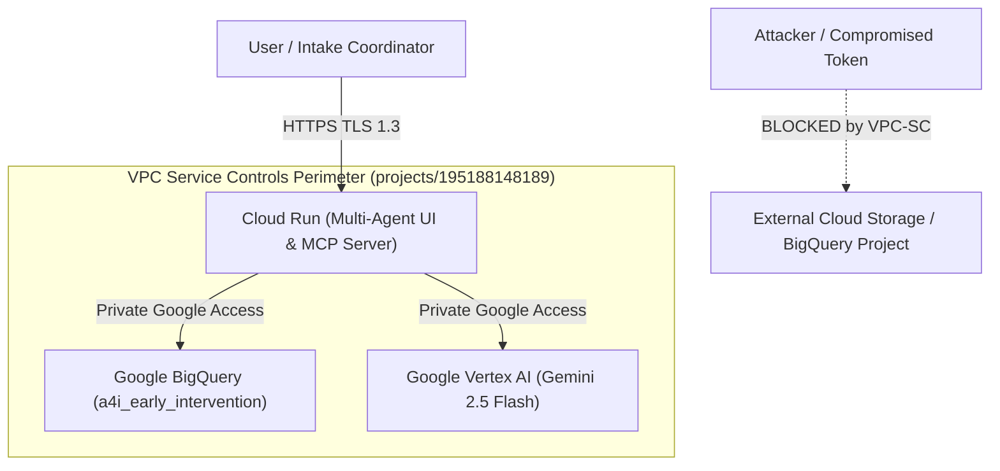

# Security & VPC Service Controls Architecture

## 1. Executive Summary
This document outlines the security architecture and **VPC Service Controls (VPC-SC)** perimeter design for the **First Milestones Early Intervention Multi-Agent & Dashboard System** on Google Cloud Platform. 

Under federal IDEA Part C regulations (34 CFR § 303) and healthcare compliance (FERPA & HIPAA), multi-hop referral chains, toddler developmental screenings, and Medicaid records must be protected against **data exfiltration, credential leakage, and unauthorized public access**.

---

## 2. Threat Model & Mitigations

### Threats Mitigated:
1. **Stolen Credential Exfiltration**: Even if a service account token is leaked or intercepted, VPC-SC blocks calls from executing outside the defined IP/VPC boundaries.
2. **Data Copying to External Projects**: Prevents running queries like `CREATE TABLE external_project.stolen AS SELECT * FROM a4i_early_intervention...`. VPC-SC denies egress of BigQuery jobs across project perimeters.
3. **Public Network Sniffing**: Cloud Run communicates with `bigquery.googleapis.com` and `aiplatform.googleapis.com` via **Private Google Access**, keeping all network packets on Google's private software-defined network.

---

## 3. VPC Service Controls Configuration

- **Perimeter Name**: `early_intervention_data_perimeter`
- **Protected Resources**: `projects/195188148189` (`qwiklabs-gcp-04-5956a6cfcbdf`)
- **Restricted Services**:
  - `bigquery.googleapis.com` (Referral Property Graph, Provider Directory, ACS Demographics)
  - `aiplatform.googleapis.com` (Gemini ADK Agent Runtime)
  - `storage.googleapis.com` (Parquet Backing Store)

### Declarative Specification:
The declarative YAML perimeter definition is located at [security/vpc_sc_perimeter.yaml](file:///config/Desktop/AgentsForImpact/security/vpc_sc_perimeter.yaml).

### Rollout Strategy (Zero-Downtime):
1. **Dry-Run Mode**: Deployed initially with `--dry-run` to log potential violations in Cloud Logging (`cloudaudit.googleapis.com/policy`) without blocking live referral routing.
2. **Audit Verification**: Review audit logs to confirm all coordinator queries succeed.
3. **Commit Dry-Run**: Enforce the perimeter live via `gcloud access-context-manager perimeters commit-dry-run`.

---

## 4. Least-Privilege IAM Matrix

| Principal | Role | Scope | Purpose |
| :--- | :--- | :--- | :--- |
| **Agent Runtime SA** | `roles/bigquery.jobUser` | Project | Execute query jobs inside Cloud Run |
| **Agent Runtime SA** | `roles/bigquery.dataViewer` | Dataset `a4i_early_intervention` | Read-only access to referral logs and directories |
| **Agent Runtime SA** | `roles/aiplatform.user` | Project | Invoke Gemini 2.5 Flash for clinical action notes |
| **Coordinators (Users)**| `roles/run.invoker` | Cloud Run Service | Access UI dashboard and MCP endpoints |
